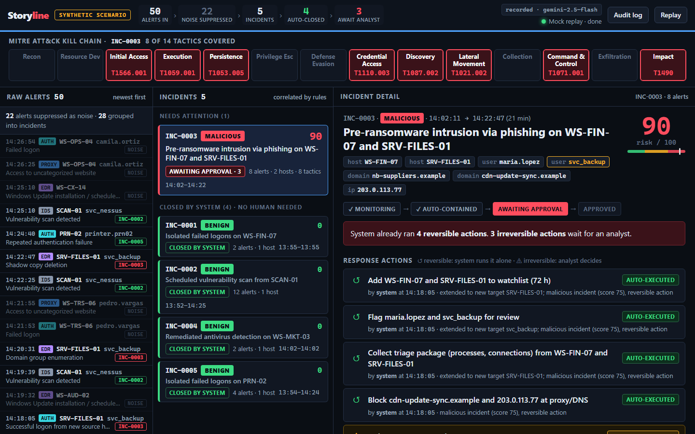
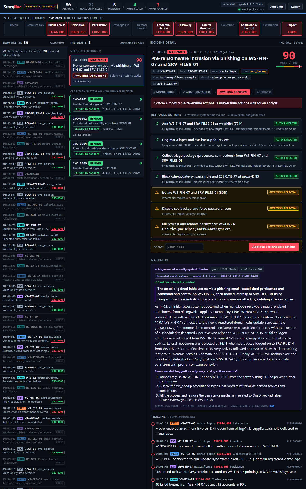

# Storyline — Alert Correlation & Incident Timeline

SOC hackathon (Alaris Security), 2026-10-24. Solo entry by Jonathan Veras, built during the event.
**All data is synthetic.**

## What it is

- **Problem:** a SOC sees fragments — 50 alerts from five tools in 35 minutes, most of them noise.
- **Solution:** Storyline turns them into **one incident with a MITRE ATT&CK timeline**, written
  reasons for every grouping, a risk score, an AI narrative and the response already started.
- **Criterion:** **Audit-First** (deterministic rules decide; the AI only narrates and suggests)
  and **autonomy by blast radius** (the system does on its own only what can be undone, logs why,
  and waits for a human on everything else).



## Demo in 60 seconds

```powershell
.\run_demo.ps1
```

The script starts the backend, waits for `/health`, makes one AI warm-up call, opens the panel and
prints **READY FOR DEMO**. Press Enter and the synthetic scenario is replayed: 35 minutes of alerts
in about 52 seconds.

What you see, left to right:

| Area | What it shows |
|---|---|
| Top bar | `50 alerts in › 22 noise suppressed › 5 incidents › 4 auto-closed › 3 await analyst`, AI mode, **SYNTHETIC SCENARIO** |
| Kill chain | The 14 ATT&CK tactics; the 8 the attack reached light up with their technique ids |
| Raw alerts (left) | The queue filling up; each alert tagged with its incident or `NOISE` |
| Incidents (center) | One malicious incident needs attention; four benign ones are **closed by system** |
| Detail (right) | Autonomy steps (monitoring → auto-contained → awaiting approval → approved), actions with **AUTO-EXECUTED** / **AWAITING APPROVAL** badges, AI narrative with its trace, timeline, correlation reasons, risk score breakdown |
| Audit log | Everything the system did alone, with its reason, plus every AI call |

During the replay the attack incident escalates live: **monitoring** (score 10–25, no action) →
**auto-contained** at 30 (watchlist, review flag, triage) → **awaiting approval** at 75 (C2 domain
blocked by the system). The analyst types a name and approves isolation, account disable and
persistence removal.

No network? `http://127.0.0.1:8000/panel/?mock=1` replays recorded data offline (the AI narrative
there is a real recorded model output, labelled as recorded).

## How it works

```
 POST /alerts (edr, proxy, auth, email_gateway, ids)
      │
      ▼
 normalizer ──── raw vendor fields → common schema + event_type (closed vocabulary)
      │
      ▼
 correlator ──── union-find over alerts; every link is a rule with a written reason   "what goes together"
      │
      ▼
 scoring ──────── ATT&CK kill chain + signals → risk 0–100 → benign / suspicious / malicious   "how bad"
      │
      ▼
 actions ──────── catalog, per target: reversible → executed by "system" + reason in /audit
      │                                irreversible → pending until POST /incidents/{id}/approve
      ▼
 AI narrator ──── background: reads the finished incident, writes narrative + hypothesis + suggestions
      │
      ▼
 panel ────────── plain HTML/JS, polls every 2 s
```

**What goes together** — deterministic rules, each leaving a reason the analyst can read:

| Rule | Links two alerts when… | Example reason |
|---|---|---|
| `same_host_window` | same host, ≤ 30 min, both carry an ATT&CK technique | "5 alerts share host WS-FIN-07 within 30 min (14:02-14:15)" |
| `user_pivot` | a successful logon on host B came from host A, ≤ 30 min after activity on A | "svc_backup logon on SRV-FILES-01 originated from WS-FIN-07" |
| `shared_infra` | two hosts contacted the same external domain or IP | "WS-A and WS-B both contacted bad.example" |
| `same_user_window` | same user on two hosts, ≤ 15 min, at least one technique | "same user u1 across hosts WS-A, WS-B within 15 min" |
| `noise_isolation` | known-noise alerts of the same type on the same host | "12 vuln_scan alerts from SCAN-01 (known scanner) grouped apart from technique alerts (13:52-14:25)" |

Noise never joins an attack by host alone, which is why the two failed logons of `maria.lopez`
seven minutes before the phishing email stay out of the attack incident (a deliberate trap).

**How bad** — points per signal, malicious ≥ 70, suspicious 30–69, benign < 30:

| Signal | Points |
|---|---|
| Kill chain depth | 5 per tactic, max 30 |
| Impact stage reached (T1490 / T1486) | 15 |
| Lateral movement (`user_pivot` / `shared_infra` across ≥ 2 hosts) | 15 |
| Privileged / service account | 10 |
| Credential access (password spraying) | 10 |
| C2 to newly registered infrastructure | 5 |
| Initial access confirmed (T1566.*) | 5 |

The scenario's attack scores **90**: 30 + 15 + 15 + 10 + 10 + 5 + 5.

## Autonomy by blast radius

| Verdict | What the system does alone | What waits for a human |
|---|---|---|
| benign, known noise only | closes the incident with a written reason (`auto_closed`) | nothing |
| benign, but an ATT&CK technique or unexplained activity | nothing yet: `monitoring`, re-scored on every alert | nothing |
| suspicious | runs reversible actions: watchlist, review flag, triage (`auto_contained`) | nothing, but it stays visible |
| malicious | runs reversible actions, incl. blocking C2 (`awaiting_approval`) | irreversible actions |

| Action | Reversible | Triggered when |
|---|---|---|
| `close_benign` | yes | benign and every alert is known noise |
| `watchlist_host` | yes | suspicious or malicious |
| `tag_user` | yes | suspicious or malicious |
| `collect_triage` | yes | suspicious or malicious |
| `block_domain` | yes | malicious with C2 |
| `isolate_host` | **no** | malicious |
| `disable_account` | **no** | malicious with a privileged account or lateral movement |
| `kill_process` | **no** | malicious with persistence |

Actions are tracked per target: when SRV-FILES-01 joined the incident, the system extended the
watchlist to that host only ("extended to new target SRV-FILES-01"), and nothing ever runs twice.
Only catalog actions execute. Actions are simulated in this prototype (see
[docs/integration.md](docs/integration.md) for where real tools plug in).

## The AI: scope and observability

The AI is a narrator, not a decision maker.

- **Bounded input.** It receives only the finished incident: timeline, techniques, entities,
  reasons, signals and action states. No raw vendor data, no other incidents.
- **Structured output.** Strict JSON schema: `narrative`, `hypothesis`, `recommended_actions`,
  `confidence`. The prompt includes today's date and forbids inventing hosts, users, IPs, domains,
  files, times or dates, changing the verdict, or claiming actions that did not run.
- **No tools.** No function calling. Nothing reads the AI's output to execute: its recommendations
  are shown as "suggestions only; only catalog actions execute".
- **Trace per call.** Model, prompt SHA-256, latency, raw response, error, time. Shown under the
  narrative, with the raw response one click away.
- **Entity verification.** Every host, user, IP, domain, time and date the model mentions is
  checked against the incident. Anything not there becomes a flag: "⚠ Not in incident — verify".
  Otherwise the panel shows "✓ 0 entities outside the incident".
- **Audited.** Every model call is an `/audit` entry (`executed_by: ai:<model>`).
- **Degrades to a stub.** No credentials, a 30 s timeout, an error or bad JSON → a deterministic
  rules-only summary, labelled "Rules-only summary (AI unavailable)". Vertex error text never
  reaches the panel or the API, only the exception type; the full text stays in the server log.
- **Never blocks.** Narration runs in a background worker; ingest and scoring never wait for it.



## Data

Synthetic only (`tools/gen_scenario.py`, deterministic): a fictional bank, NovaBanco. External
domains use `.example`, external IPs come from the documentation range `203.0.113.0/24`
(RFC 5737), internal ones from `10.20.0.0/16`.

The scenario is a pre-ransomware intrusion: 8 attack alerts over 20 minutes across 2 hosts and 2
users, hidden among 42 noise alerts (vulnerability scan, isolated failed logons, Windows Update,
remediated adware, old uncategorized websites, a printer with a bad password).

| Step | Time | Source | What happened | ATT&CK |
|---|---|---|---|---|
| A1 | 14:02 | email | Macro attachment delivered to maria.lopez | T1566.001 Phishing: Spearphishing Attachment |
| A2 | 14:06 | EDR | WINWORD.EXE spawned encoded PowerShell | T1059.001 PowerShell |
| A3 | 14:07 | proxy | Connection to a 2-day-old domain | T1071.001 Web Protocols |
| A4 | 14:09 | EDR | Scheduled task `OneDriveSyncHelper` | T1053.005 Scheduled Task |
| A5 | 14:15 | auth | 40 failed logons against 12 accounts in 90 s | T1110.003 Password Spraying |
| A6 | 14:18 | auth | svc_backup logs on to SRV-FILES-01 from WS-FIN-07, first time | T1021.002 SMB/Windows Admin Shares |
| A7 | 14:20 | EDR | `net group "Domain Admins" /domain` | T1087.002 Domain Account Discovery |
| A8 | 14:22 | EDR | `vssadmin delete shadows /all /quiet` | T1490 Inhibit System Recovery |

Techniques and tactics follow MITRE ATT&CK® Enterprise (https://attack.mitre.org/). ATT&CK is a
registered trademark of The MITRE Corporation.

## Measured results

Measured with `tools/benchmark.py` on the demo laptop (Windows 11, Intel64, Python 3.12.10),
3 runs each. Alerts are posted back to back, so times are processing cost, not scenario time.
Full tables: [rules only](docs/benchmark-results.md), [with live AI](docs/benchmark-results-ai.md).

| Metric | Run 1 | Run 2 | Run 3 |
|---|---|---|---|
| Alerts in | 50 | 50 | 50 |
| Incidents formed | 5 | 5 | 5 |
| Alerts suppressed as noise | 22 | 22 | 22 |
| Incidents needing a human | 1 | 1 | 1 |
| Attack incident = exactly the 8 attack alerts, malicious | yes | yes | yes |
| Attack risk score | 90 | 90 | 90 |
| Malicious at alert # (scenario minutes after first attack alert) | 38 (15.9) | 38 (15.9) | 38 (15.9) |
| `POST /alerts` median / p95 (ms) | 23.7 / 60.6 | 24.6 / 59.4 | 37.0 / 66.9 |
| All 50 alerts processed (ms) | 1628 | 1604 | 1978 |
| AI call latency, gemini-2.5-flash (ms) | 5688 | 7555 | 6659 |
| AI narrative ready after the last alert (ms) | 15464 | 10832 | 13310 |
| AI entities not in the incident (flags) | 0 | 0 | 0 |

The AI rows come from the separate `--ai` run (its rule-side numbers are in its own table).

## Stack and setup

Python 3.12 · FastAPI + Uvicorn · Pydantic · httpx · Gemini 2.5 Flash on Vertex AI (`google-genai`)
· plain HTML/CSS/JS panel (no build step, no external assets) · pytest.

Windows (PowerShell), from the repo folder:

```powershell
py -3.12 -m venv .venv
.venv\Scripts\python.exe -m pip install -r requirements.txt
copy .env.example .env      # optional: fill in Vertex AI settings; without them it runs rules-only

.\run_demo.ps1              # full demo (add -NoAI for rules only, -Stop to stop the backend)
```

Manual pieces:

```powershell
.venv\Scripts\python.exe -m uvicorn backend.app.main:app --port 8000      # panel at http://127.0.0.1:8000/panel/
.venv\Scripts\python.exe tools\gen_scenario.py --replay --speed 40         # replay the scenario
.venv\Scripts\python.exe tools\check_ai.py                                 # AI warm-up / credential check
.venv\Scripts\python.exe tools\benchmark.py                                # 3 measured runs
.venv\Scripts\python.exe -m pytest -q                                      # tests
```

The service-account JSON lives outside the repo; `.env` is git-ignored. The only external host
the app contacts is Vertex AI. API contract: `contracts/incident.schema.json`; integration notes:
[docs/integration.md](docs/integration.md); write-up: [docs/writeup.md](docs/writeup.md).

## AI used to build it

Built with Claude Code during the event. Every task is logged with time, what and why in
[docs/ai-usage.md](docs/ai-usage.md), with a column for my own review. Two project agents are in
[.claude/agents/](.claude/agents/):

- [`auditor`](.claude/agents/auditor.md): an independent read-only reviewer, run after **every**
  commit. It found real defects that were fixed with tests — e.g. one bad alert could freeze
  ingest, an offline fixture showed hand-written text as model output, and Vertex error text
  could have shown the project name on screen.
- [`ui-designer`](.claude/agents/ui-designer.md): owns the panel only.

Design notes written before the event (no code) are in `docs/prep/`.

## Tests

**151 tests** (`.venv\Scripts\python.exe -m pytest -q`, about 40 s, no network: the AI is replaced
by a fake client).

| File | Tests | Covers |
|---|---|---|
| `test_scenario.py` | 17 | scenario ground truth, synthetic-only data, replay (health wait, retry, no retry on 4xx) |
| `test_schema.py` | 12 | contract validity, bad values and timestamps rejected |
| `test_core.py` | 36 | normalizer, each correlation rule, scoring, the attack incident, the maria.lopez trap |
| `test_api.py` | 47 | every route, autonomy, approval, stable incident ids replaying alert by alert, no double execution, rollback on bad input |
| `test_ai.py` | 34 | trace, prompt contract, warm-up, timeout and error fallbacks, entity flags, no secrets in errors, reset during a call, AI never changes actions |
| `test_fixtures.py` | 3 | offline fixtures match the backend; recorded AI is a real call |
| `test_benchmark.py` | 2 | the benchmark runs and checks correctness |

A green test proves little if it would also pass on broken code. So, for the important rules, I
broke the code on purpose and checked that the right test failed: treating isolated failed logons
as attack evidence, using the scanned host instead of the scanner, letting `unknown` alerts join by
host, auto-closing anything without a technique, removing the ingest rollback, exposing raw
Vertex errors, and dropping the reset guard on AI calls. Twice the test still passed — the
duplicate-AI-call and reset-race tests had the wrong timing — and both tests were rewritten until
they failed on the bug and passed on the fix.
